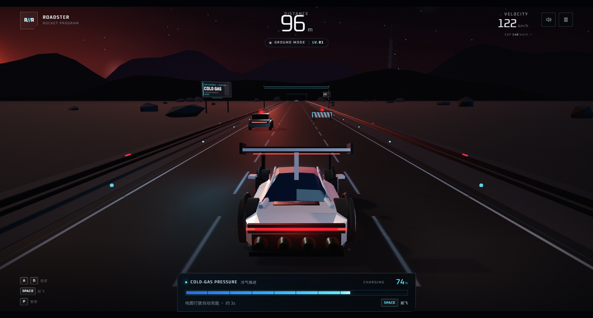
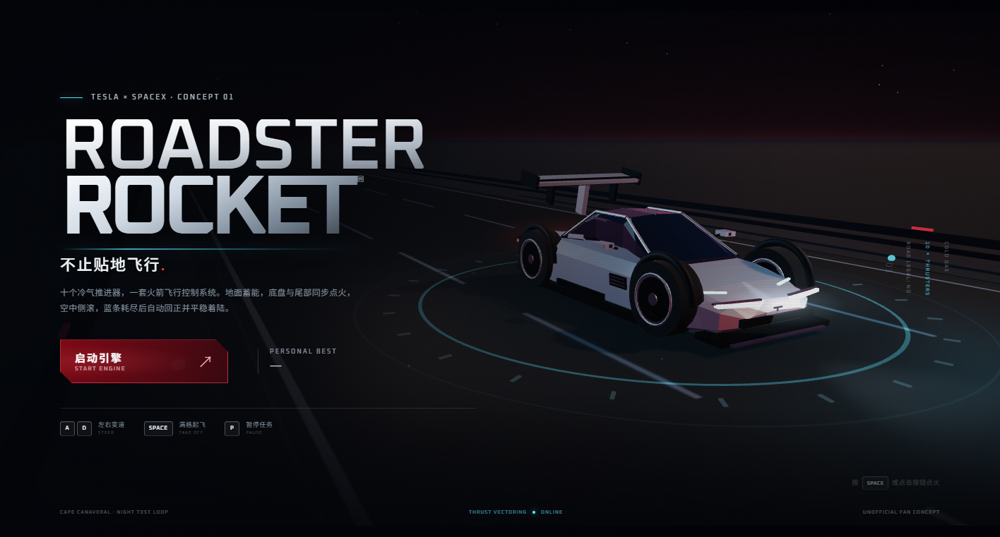
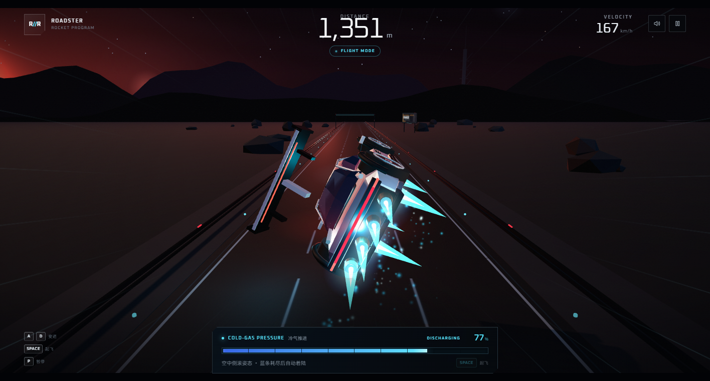
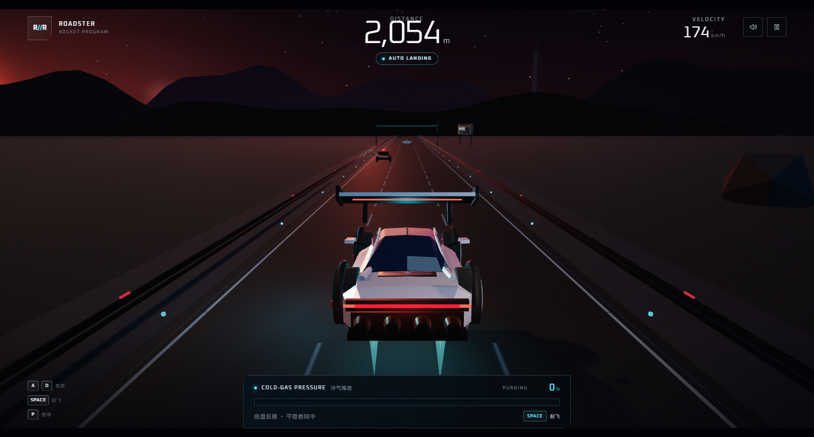
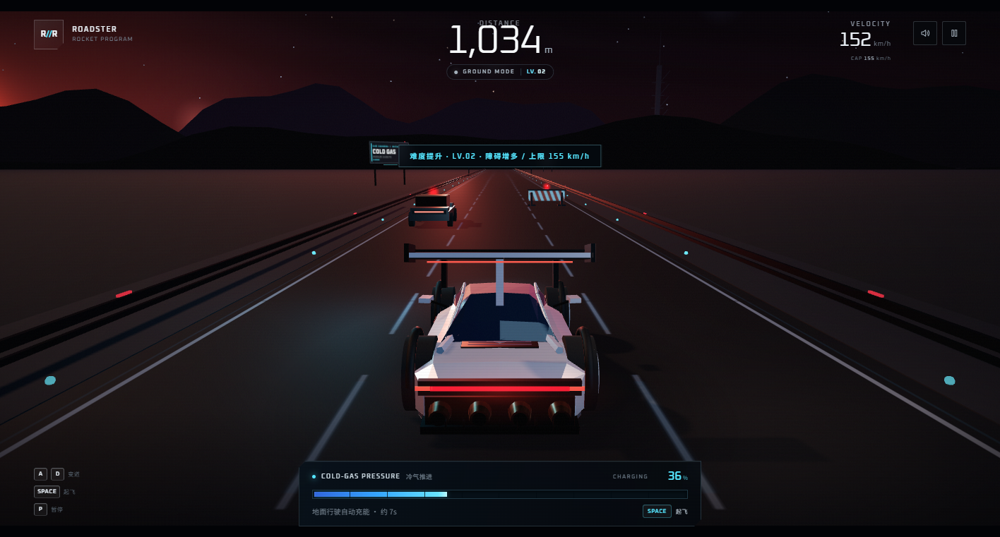
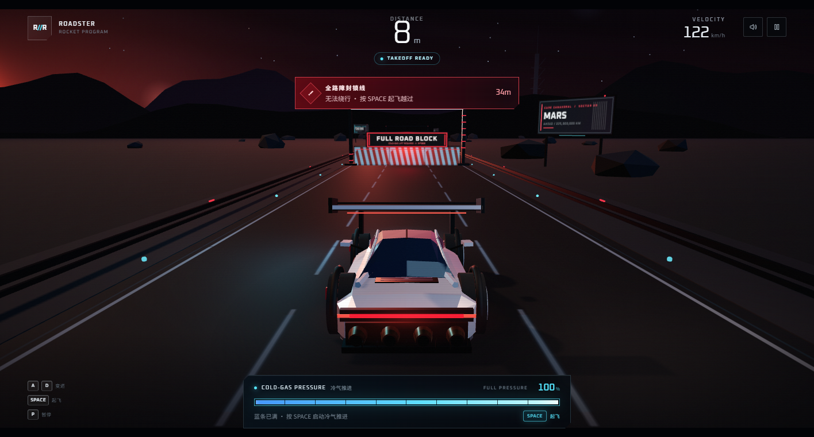
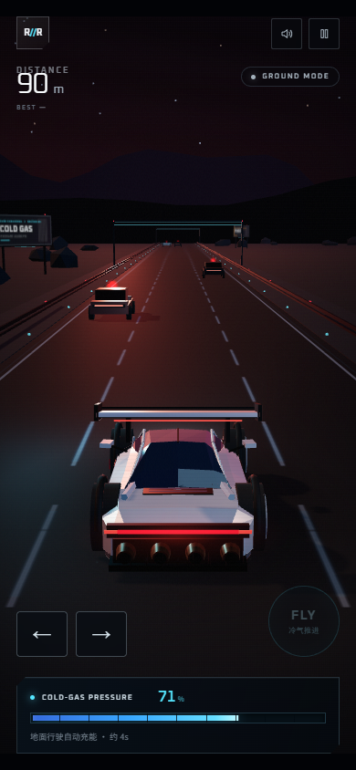

# ROADSTER // ROCKET

一款使用 **Three.js** 制作的 3D 无尽飞行汽车游戏。灵感来自 Tesla Roadster Rocket 概念：银色楔形车身、冷气推进器、夜间荒漠测试公路。



### 更多预览

| 机库 / 主菜单 | 空中侧滚 |
| --- | --- |
|  |  |

| 平稳反推着陆 | 难度提升 |
| --- | --- |
|  |  |

| 飞越全路障 | 移动端 |
| --- | --- |
|  |  |

## 玩法

- 汽车持续向前行驶，使用 **A / D** 或 **← / →** 变道，也可以左右滑动。
- 地面行驶时，底部蓝色 **COLD-GAS PRESSURE** 气压条会自动充能。
- 蓝条满格后按 **SPACE**（触屏按 **FLY**）启动冷气推进器，飞越全路障与车辆。
- **起飞瞬间，底盘升力喷口与尾部推进器同时点火**；进入空中后车辆会绕车身前后轴侧向翻滚，呈现侧滚飞行姿态。
- 飞行会持续消耗蓝条。蓝条接近耗尽时，车辆自动回正、底盘反推，并以柔和的速度曲线平稳接地。
- 撞上任何车辆、路障或封锁线即任务终止。
- 最终得分 = 汽车跑过的距离（米）。个人最佳成绩会保存在浏览器本地。

### 难度递增

每行驶 **1000m**，难度等级自动 +1：

- **障碍物数量**：双车道障碍出现概率提高，同时障碍行间距缩短，单位距离内的障碍更密集。
- **速度上限**：地面速度上限每级提高 **4 m/s（14.4 km/h）**，从 LV.01 的 140 km/h 提升至 LV.15 的 342 km/h。
- HUD 顶部显示当前难度 `LV.` 和速度上限 `CAP`；升级时会出现提示。
- 最大难度为 LV.15，之后维持最高强度。

### 关键操作

| 操作 | 键盘 | 触屏 |
| --- | --- | --- |
| 向左 / 向右变道 | `A` / `D` 或 `←` / `→` | 左右滑动，或点击底部箭头 |
| 满格起飞 | `SPACE` | `FLY` |
| 暂停 / 继续 | `P` 或 `Esc` | 右上角暂停按钮 |
| 重新开始 | `R` | 结果页按钮 |
| 静音 | `M` | 右上角声音按钮 |

## 运行

需要本地静态服务器（ES Module 不能直接通过 `file://` 加载）。

双击 **`start-game.cmd`**，或在项目目录执行：

```bash
node serve.mjs
```

然后打开 <http://127.0.0.1:4173>。

也可以用任意静态服务器，例如：

```bash
python -m http.server 4173
```

## 技术细节

- Three.js `0.180.0`，全部资源本地化，不依赖 CDN。
- 程序化车身：自定义截面放样、车顶玻璃舱、主动尾翼、五辐轮圈、冷气喷口与动态尾焰。
- 双组推进表现：底盘升力喷口与尾部推进器同步点火，侧向翻滚，落地前自动回正。
- 平稳着陆：蓝条低于阈值后切换到底盘反推，使用 smootherstep 高度曲线与零触地速度。
- 分级难度：每 1000m 提升等级，递增双车道障碍概率、障碍密度和速度上限，并在 HUD 与升级提示中同步显示。
- 程序化场景：黄昏天空 Shader、星空、山脉、公路纹理、路肩灯、龙门架、广告牌和远景发射塔。
- 无限公路对象使用共享模板与克隆，避免长时间游玩时重复创建材质和纹理。
- 程序化 Web Audio 引擎声、风噪、点火、充能、碰撞与擦身音效。
- 响应式 HUD，支持桌面、横屏与竖屏触控。

## 文件

```text
index.html              页面结构 / HUD / 菜单
src/main.js             游戏循环、状态机、输入、相机、粒子与音频调度
src/car.js              程序化 Roadster 车身与飞行姿态
src/world.js            公路、环境、障碍物与碰撞
src/audio.js            Web Audio 音效
src/style.css           界面样式与响应式布局
vendor/                 Three.js 本地构建
assets/                 Oxanium 字体
serve.mjs               无依赖静态服务器
start-game.cmd          Windows 一键启动
preview/                游戏预览图
```

> 非官方粉丝作品，与 Tesla、SpaceX 无关联。画面中的车辆是基于公开概念制作的原创程序化模型。

## 灵感参考

- [Tesla Roadster EV debuts with SpaceX thruster technology to fly through the air — Notebookcheck](https://www.notebookcheck.net/Tesla-Roadster-EV-debuts-with-SpaceX-thruster-technology-to-fly-through-the-air.1425722.0.html)
- [Tesla unveils 'flying car' — NHK WORLD-JAPAN](https://www3.nhk.or.jp/nhkworld/news/20261017de60831/)

## 第三方资源

- [Three.js](https://threejs.org/) — MIT License。
- [Oxanium](https://fonts.google.com/specimen/Oxanium) — SIL Open Font License。
